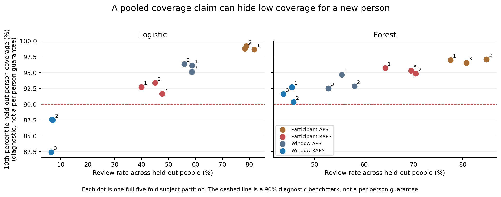

# Conformal Calibration Under New-Participant Shift

I compared two ways of calibrating conformal prediction when the test person was never seen during training or calibration.

## Start Here

Open [unseen_person_conformal.ipynb](unseen_person_conformal.ipynb). It has the UCI HAR results, a feature-shift check, a small size-imbalance simulation, and the external WISDM run. The saved outputs can be read without installing anything.

[Quick check](#run-it) · [Reproduce the results](#reproduce-the-results) · [Contribute](CONTRIBUTING.md) · [Open questions](#open-questions)

## What It Compares

- **Window calibration:** every calibration window gets equal weight.
- **Participant-balanced calibration:** every calibration participant gets equal total weight.
- **Decision rule:** a one-label set is accepted; a larger set is reviewed.

The models are logistic regression and random forest. Prediction sets use APS/RAPS scores with a 90% nominal coverage target.

## UCI HAR Result

Participant-balanced calibration improved the lower tail of held-out-person coverage, but it also raised the review rate.

| Model | RAPS rule | 10th-person coverage | Review rate |
| --- | --- | ---: | ---: |
| Logistic | Window | 85.8% | 6.7% |
| Logistic | Participant-balanced | 92.6% | 44.2% |
| Forest | Window | 91.6% | 45.0% |
| Forest | Participant-balanced | 95.3% | 68.1% |

These are means across three repeated participant partitions at a 90% nominal target. "10th-person coverage" is the 10th percentile of the participant-level coverage rates, not coverage for a particular person. Review rates give each participant equal weight.

The table reports the original saved run. An automated fresh-environment rerun preserved the coverage/review tradeoff but changed some numerical values, including two rounded table entries. See the [reproduction record](REPRODUCIBILITY.md) for both sets of values, measured differences, and the current environment. The cause of the differences has not been isolated.



The feature-shift plot is only a correlation check. The toy simulation shows what can happen when a few people contribute most of the windows.

## WISDM Check

The same setup is run on WISDM's transformed phone-accelerometer windows. The official folder contained six files that were byte-for-byte copies of subject 1610's file, so the code drops those aliases before splitting. The run uses 44 file-level subjects, 18 activities, and 20,650 windows.

I included WISDM as a second check. The review policy itself is not very practical there because the 18-class sets are wide.

## Run It

Use Python 3.11 or 3.13. The dependency versions are specified in [requirements.txt](requirements.txt).

```bash
git clone https://github.com/Smokeybear10/conformal-calibration-under-shift.git
cd conformal-calibration-under-shift
python -m venv .venv
source .venv/bin/activate
python -m pip install -r requirements.txt
python -m unittest discover -s tests -v
python smoke_test.py
```

On Windows PowerShell, activate with `.venv\Scripts\Activate.ps1` instead.

The tests and smoke check need no dataset downloads. Tests cover finite-sample thresholds, participant weights, probability ties, participant-separated splits, and the saved summary calculations. The smoke check fits both model families on synthetic participants and exercises all four calibration methods at both alpha values. It writes no files and does not validate the empirical findings.

Run `jupyter lab` to explore the notebook after setup.

## Reproduce the Results

Run from the repository root. These commands write to `work/` so the committed reference results stay available for comparison:

```bash
python run_experiment.py --output work/uci
python shift_diagnostic.py --results-dir work/uci
python hierarchical_simulation.py --output work/uci
python wisdm_replication.py --output work/wisdm
```

The first run downloads about 61 MB for UCI HAR and 310 MB (296 MiB) for WISDM. Downloads are checked against the archive hashes in the runners. Data are cached in `data/` and `wisdm_data/`. Full runs take several minutes depending on hardware; the simulation runs 1,000 repetitions per regime. The repository includes derived tables and figures, not raw source archives or prediction dumps.

Compare `work/uci/repeat_summary.csv` with [`results/repeat_summary.csv`](results/repeat_summary.csv), and `work/wisdm/repeat_summary.csv` with [`wisdm_results/repeat_summary.csv`](wisdm_results/repeat_summary.csv). The `subject_metrics.csv` files retain each person's results. `summary.json` records source hashes, row counts, and elapsed time; `protocol.json` records the evaluation design and participant assignments. Small floating-point differences across platforms are possible. Report the metric and size of any discrepancy in a [reproduction issue](https://github.com/Smokeybear10/conformal-calibration-under-shift/issues/new?template=reproduction.yml).

## Experimental Scope

The UCI HAR experiment uses three seeds and five participant folds: 12 people for fitting, 12 for calibration, and six for testing in each fold. Logistic regularization is selected with participant-separated cross-validation inside the fit partition. WISDM uses three seeds and four participant folds after removing byte-identical file aliases. The full assignments are in the saved protocols.

Participant-balanced calibration relies on hierarchical exchangeability for its formal coverage statement. It does not guarantee 90% coverage for every participant. UCI HAR has overlapping windows, both datasets contain within-person dependence, and neither study measures the accuracy or cost of human review. These results describe the observed tradeoff under the stated protocol.

## Open Questions

At a fixed review budget, which calibration approach best protects the worst-covered participants? A useful next experiment would specify the budget-selection procedure before evaluating held-out people, then report achieved review rates and participant-level coverage together. This is a proposed extension, not a result of the current study.

Independent reproductions, careful bug reports, and methodological reviews are welcome. See [CONTRIBUTING.md](CONTRIBUTING.md) for setup, experimental boundaries, and review expectations, or browse the [open issues](https://github.com/Smokeybear10/conformal-calibration-under-shift/issues).

## License

The original code and documentation are available under the [MIT License](LICENSE). External datasets remain subject to their own terms; the source pages are linked below. Raw datasets are downloaded separately and are not included in this repository.

## Data and Methods

- [UCI Human Activity Recognition Using Smartphones](https://doi.org/10.24432/C54S4K)
- [WISDM Smartphone and Smartwatch Activity and Biometrics Dataset](https://doi.org/10.24432/C5HK59)
- [Adaptive Prediction Sets](https://proceedings.neurips.cc/paper_files/paper/2020/file/244edd7e85dc81602b7615cd705545f5-Paper.pdf)
- [Distribution-Free Inference With Hierarchical Data](https://arxiv.org/abs/2306.06342)
